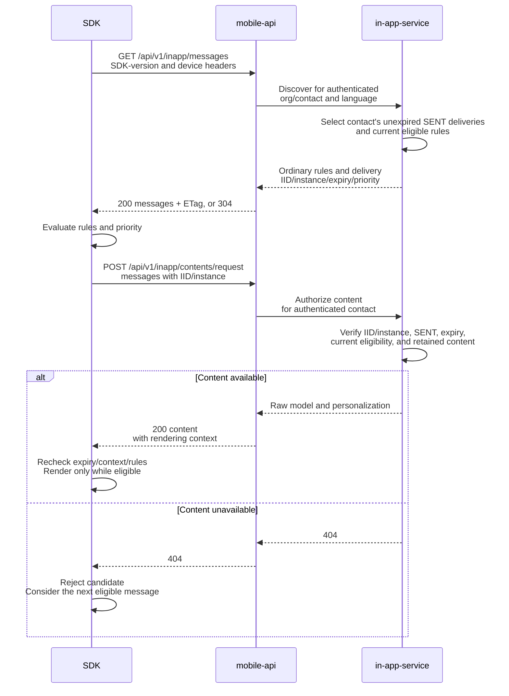
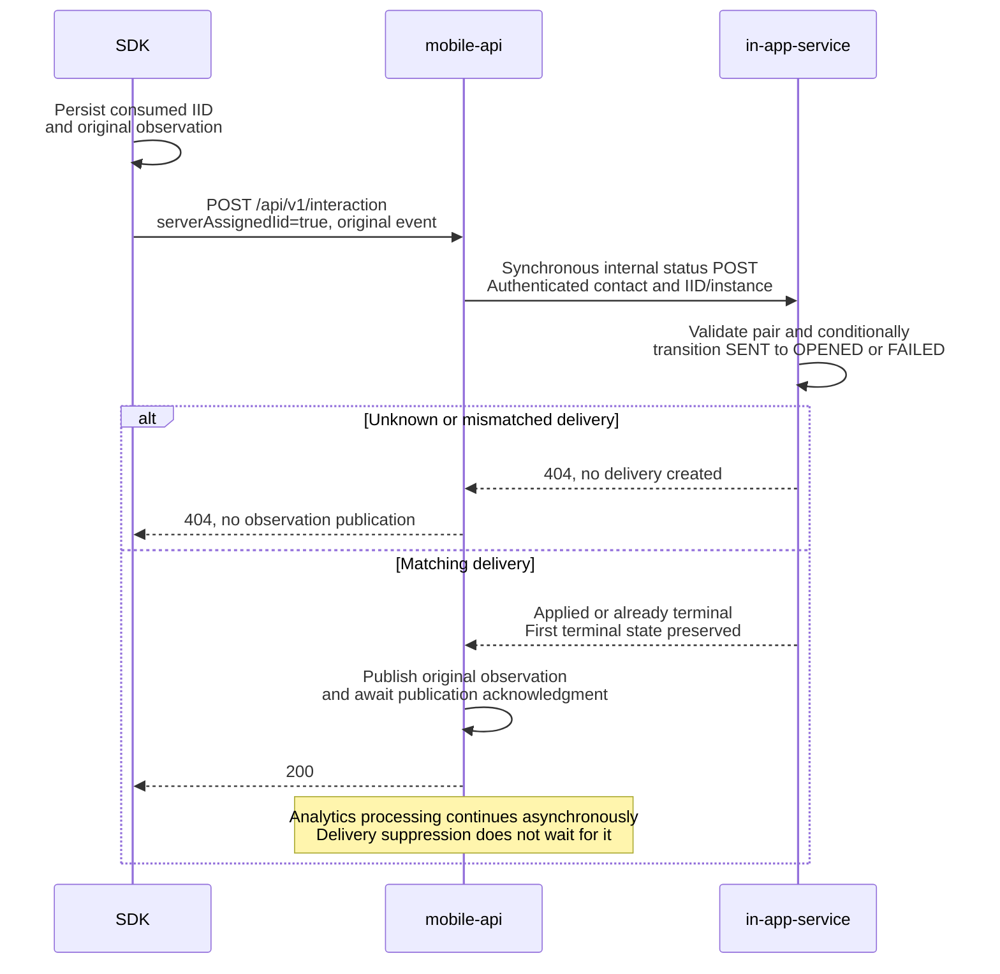
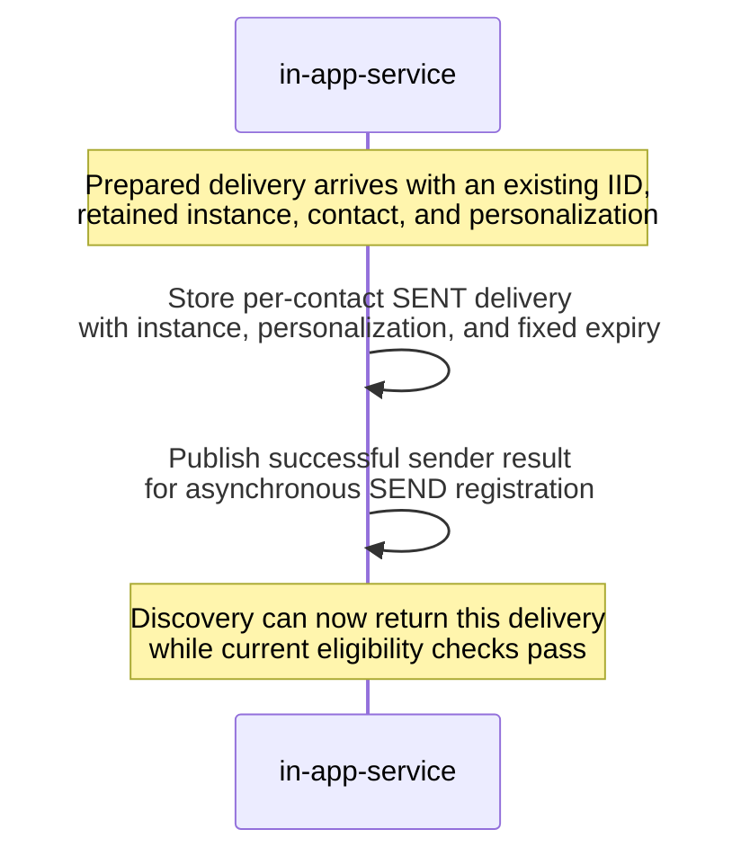

# iOS SDK InApp delivery

The SDK implementation is committed in this checkout. Documentation was
reconciled with backend contracts on November 10, 2026. Native certification,
release, and coordinated backend deployment remain unverified by the recorded
checks.

You can review the SDK behavior and backend contract here without access to
another repository. Source and test links stay within this repository.

## Contents

- [What changes for the SDK](#what-changes-for-the-sdk)
- [Identifiers and service responsibilities](#identifiers-and-service-responsibilities)
- [SDK flow](#sdk-flow)
- [Public API compatibility](#public-api-compatibility)
- [Public endpoints: before and after](#public-endpoints-before-and-after)
- [Display rules and content](#display-rules-and-content)
- [Status, retries, and local state](#status-retries-and-local-state)
- [iOS implementation](#ios-implementation)
- [Verification status and remaining checks](#verification-status)
- [Backend reference](#backend-reference)
- [Review history](#review-history)
- [Verification history](#verification-history)

## What changes for the SDK

An ordinary InApp becomes eligible through published display rules, including
optional segment conditions. A workflow can now create a separate delivery for a
specific contact before that contact opens the app. This document calls it a
**server delivery**. A segment condition alone does not create one.

| Concern | Ordinary InApp before this change | Added behavior |
| --- | --- | --- |
| Identity | The SDK generates an interaction UUID for a display attempt. | The backend creates an interaction UUID before discovery; the SDK reuses it. |
| Eligibility | Published rules, targeting, segment membership, and frequency determine eligibility. | The contact needs an unexpired `SENT` delivery and a currently available instant message. Ordinary publication is not required. Current rules still apply; the backend disables only message-level frequency for these deliveries. |
| Content | A message instance is requested by `messageInstanceId`. | The same endpoint accepts an IID/instance pair and returns that delivery's prepared personalization. |
| Selection | Existing ordinary-message selection applies. | Eligible server deliveries take precedence over eligible ordinary messages. Higher numeric priority wins; visible content is not interrupted. |
| Observations | OPENED/FAILED use the mobile-api POST; clicks use the existing interaction-status transport. | All standalone InApp OPENED/CLICKED/FAILED use the mobile-api POST, including ordinary clicks. Push and push-embedded InApp keep their existing transport. |
| Repeat behavior | Ordinary frequency rules control later displays. | OPENED, CLICKED, or FAILED consumes that particular delivery locally and ends its server availability. Another delivery of the same message has another IID. |

The SDK does not choose or understand a workflow mode. It branches on whether an
IID was received, honors expiry and priority, and evaluates the supplied rules.
Do not add `inWorkflow`, `deliveryMethod`, or `includeWorkflow` to SDK requests.

## Identifiers and service responsibilities

| Owner | Responsibility relevant to the SDK |
| --- | --- |
| mobile-api | Authenticates the application/device, resolves the contact, gates discovery by SDK version, forwards content, completes server delivery state synchronously, and publishes observations. It also serves Mobile Push; this change does not move Push tracking into the InApp POST. |
| in-app-service | Receives prepared deliveries, stores per-contact availability, supplies discovery/content, and owns the terminal delivery state. |

| Identifier | Meaning and SDK use |
| --- | --- |
| `messageId` | The authored message. Used with its display rules; not a unique delivery. |
| `messageInstanceId` | A retained version of message content, including the selected language. Multiple deliveries can share it. |
| `iid` | The interaction UUID. For a server delivery it identifies one send to a contact, not the template. Preserve it for content lookup and every observation. Generate a UUID only when discovery supplied no IID. |
| `serverAssignedIid` | Observation-only boolean: `true` means the IID came from the server. Omitted/false retains the SDK-generated path. Persist this flag with retries; do not infer it from a UUID's format. |

An **observation** is the SDK's report of an OPENED, CLICKED, or FAILED event.
**Local suppression** means remembering that a server delivery's IID has already
been used, so the SDK does not show it again. A **terminal state** is OPENED or
FAILED in in-app-service; the delivery is no longer available to the contact.

## SDK flow

1. Fetch the discovery list. A supported SDK can receive ordinary messages and
   server deliveries together.
2. Evaluate the supplied rules and select the highest-priority eligible item.
   Server deliveries use priority `20`; ordinary messages use `10` by default.
3. Authorize a server delivery's content online using its IID and message
   instance. If it is unavailable, consider the next eligible candidate.
4. Display only while the candidate remains eligible. Preserve a received IID;
   generate an IID only for an ordinary display attempt.
5. Record the observation. For a server delivery, retain a local consumed-IID
   marker and report `serverAssignedIid` as `true`. Mobile-api ends availability
   synchronously before acknowledging the observation.

### Find and display a message



### Report a server delivery event

The SDK reports actual visibility as OPENED, a click as CLICKED, and a display
failure as FAILED. Mobile-api updates in-app-service before publishing the
observation. Ordinary events use the same public POST but skip the internal
status update. See [status and retries](#status-retries-and-local-state) for
event timing, failure handling, and the limits of duplicate prevention.



## Public API compatibility

The SDK calls mobile-api on `https://mobile-api.reteno.com`. Paths below include
the existing public `/api` prefix. Keep the existing application access key,
device identity, and SDK-version headers; do not send backend `orgId` or
`contactId` to select another delivery owner.

| Method and path | Contract |
| --- | --- |
| `GET /api/v1/inapp/messages` | One discovery list can contain ordinary messages and the authenticated contact's server deliveries. Supports `If-None-Match` and ETag/304. |
| `POST /api/v1/inapp/contents/request` | Choose ordinary message instance IDs or server IID/instance references. These are separate non-null request forms. |
| `POST /api/v1/interaction` | Reports standalone InApp OPENED, CLICKED, or FAILED, with the original identity and observation time. |
| `POST /api/v1/inapp/async-rules/check` | Existing segment checks remain in use; asynchronous eligibility must not invert candidate priority. |

Mobile-api admits server deliveries through the existing `X-Reteno-SDK-Version`
header. Its configurable minimums default to `3.0.0` for Android and iOS.
Recognized header examples are `Android 3.0.0` and `iOS SDK 3.0.0`. Missing,
malformed, unknown-platform, or below-minimum versions receive ordinary
discovery only; an empty/invalid configured minimum disables server deliveries
for that platform. Configure the actual certified versions before rollout rather
than changing a version string to bypass the gate.

In-app-service classifies discovery using the current message's internal
instant-message marker, independently of availability TTL (time to live).
The old instance-only content path uses the marker frozen in each instance;
later message edits do not reclassify that instance. Instant messages and
instances are excluded from these respective ordinary paths. The marker is not
an SDK field; the SDK follows the presence of an IID. A mixed discovery response
does not require a mixed content request.

`POST /api/v1/inapp/async-rules/check` and the existing push-embedded message
lookup keep their current contracts. They have no feature-specific before/after
payload change.

## Public endpoints: before and after

Before means the ordinary InApp contract before this feature. After means the
contract implemented by this change, not confirmation of production rollout.
Discovery and content samples omit unchanged rule predicates and renderer-model
members. Interaction samples show complete request bodies. The [display rules and content](#display-rules-and-content) section includes a mixed discovery
response and a content request for two deliveries of one instance. The same
authentication headers and public endpoint paths remain in use.

### SDK: GET /api/v1/inapp/messages

<table>
<thead>
<tr><th>Before</th><th>After</th></tr>
</thead>
<tbody>
<tr>
<td>
<p><strong>Request:</strong> <code>GET /api/v1/inapp/messages</code> with the existing device and SDK-version headers.</p>
</td>
<td>
<p><strong>Request:</strong> same URL and headers. No new query parameter.</p>
</td>
</tr>
<tr>
<td>
<p><strong>Ordinary response item:</strong></p>
<pre lang="json">{
  "messageId": 7002,
  "messageInstanceId": 8002,
  "displayRules": {},
  "layout": "FULL"
}</pre>
</td>
<td>
<p><strong>Ordinary response item:</strong></p>
<pre lang="json">{
  "messageId": 7002,
  "messageInstanceId": 8002,
  "displayRules": {},
  "layout": "FULL",
  "priority": 10
}</pre>
</td>
</tr>
<tr>
<td>
<p><strong>Server delivery item:</strong> not available.</p>
</td>
<td>
<p><strong>Additional item in the same <code>messages</code> list:</strong></p>
<pre lang="json">{
  "messageId": 7001,
  "messageInstanceId": 8001,
  "iid": "11111111-1111-4111-8111-111111111111",
  "displayRules": {},
  "layout": "FULL",
  "expiresAt": "2026-11-14T10:00:00Z",
  "priority": 20
}</pre>
</td>
</tr>
<tr>
<td>
<p>The SDK-version header already supported layout compatibility filtering.</p>
</td>
<td>
<p>The same header also gates server deliveries: recognized Android/iOS versions at or above the configured minimum receive their contact&#x27;s eligible deliveries. The default minimum is <code>3.0.0</code> for each platform.</p>
</td>
</tr>
<tr>
<td>
<p><code>If-None-Match</code> and ETag/304 apply to the ordinary list.</p>
</td>
<td>
<p>The same mechanism covers the returned list, including delivery IIDs, expiry, priority, and rules. A 304 never clears local suppression.</p>
</td>
</tr>
</tbody>
</table>

The response envelope still uses `messages` (empty-list example):

```json
{
  "messages": []
}
```

Keep the received IID. See [selection rules](#discovery-rules-and-priority) for
priority, frequency, and fallback behavior.

### SDK: POST /api/v1/inapp/contents/request

<table>
<thead>
<tr><th>Before</th><th>After</th></tr>
</thead>
<tbody>
<tr>
<td>
<p><strong>Ordinary request:</strong></p>
<pre lang="json">{
  "messageInstanceIds": [
    8002
  ]
}</pre>
</td>
<td>
<p><strong>Ordinary request:</strong></p>
<pre lang="json">{
  "messageInstanceIds": [
    8002
  ]
}</pre>
<p>The ordinary request remains supported.</p>
</td>
</tr>
<tr>
<td>
<p><strong>Server delivery request:</strong> not available.</p>
</td>
<td>
<p><strong>New alternative request:</strong></p>
<pre lang="json">{
  "messages": [
    {
      "iid": "11111111-1111-4111-8111-111111111111",
      "messageInstanceId": 8001
    }
  ]
}</pre>
</td>
</tr>
<tr>
<td>
<p><strong>Ordinary content item:</strong></p>
<pre lang="json">{
  "messageInstanceId": 8002,
  "layoutType": "FULL",
  "layoutParams": null,
  "model": {}
}</pre>
</td>
<td>
<p><strong>Ordinary content item:</strong> same fields; no <code>iid</code> or <code>personalisation</code>.</p>
</td>
</tr>
<tr>
<td>
<p>No server-delivery content response.</p>
</td>
<td>
<p><strong>Server content item:</strong></p>
<pre lang="json">{
  "iid": "11111111-1111-4111-8111-111111111111",
  "messageInstanceId": 8001,
  "layoutType": "FULL",
  "layoutParams": null,
  "model": {},
  "personalisation": {
    "orderReference": "order-1"
  }
}</pre>
</td>
</tr>
<tr>
<td>
<p>Message instance-only request validation requires a nonempty <code>messageInstanceIds</code>.</p>
</td>
<td>
<p>The existing form retains its validation. The new form requires 1–100 IID/instance pairs; both request forms non-null are invalid. An omitted/null unused form is allowed.</p>
</td>
</tr>
<tr>
<td>
<p>No per-server delivery authorization in this operation.</p>
</td>
<td>
<p>For <code>messages</code>, mobile-api resolves the authenticated contact; in-app-service checks the exact delivery, message instance, expiry, SENT state, and current instant-message/workflow eligibility. Unavailable content returns 404. Instances with a frozen instant-message marker cannot use the ordinary form.</p>
</td>
</tr>
</tbody>
</table>

The response envelope still uses `contents` (empty-list example):

```json
{
  "contents": []
}
```

One request selects one content branch. Split mixed discovery into the
appropriate content requests; do not put both non-null request forms into one
body.

### SDK: POST /api/v1/interaction

<table>
<thead>
<tr><th>Before</th><th>After</th></tr>
</thead>
<tbody>
<tr>
<td>
<p><strong>Accepted statuses:</strong> OPENED and FAILED.</p>
</td>
<td>
<p><strong>Accepted statuses:</strong> OPENED, CLICKED, and FAILED for standalone InApp.</p>
</td>
</tr>
<tr>
<td>
<p><strong>Ordinary OPENED request:</strong></p>
<pre lang="json">{
  "iid": "33333333-3333-4333-8333-333333333333",
  "messageInstanceId": 8002,
  "time": "2026-11-06T10:05:00Z",
  "status": "OPENED"
}</pre>
</td>
<td>
<p><strong>Ordinary OPENED request:</strong> the same body remains valid. Omitted <code>serverAssignedIid</code> means false.</p>
</td>
</tr>
<tr>
<td>
<p>No <code>serverAssignedIid</code> field.</p>
</td>
<td>
<p><strong>Server OPENED request:</strong></p>
<pre lang="json">{
  "iid": "11111111-1111-4111-8111-111111111111",
  "messageInstanceId": 8001,
  "time": "2026-11-06T10:05:00Z",
  "status": "OPENED",
  "serverAssignedIid": true
}</pre>
</td>
</tr>
<tr>
<td>
<p>Clicks used the separate interaction-status request. No <code>action</code> field on this POST.</p>
</td>
<td>
<p><strong>Server CLICKED request:</strong></p>
<pre lang="json">{
  "iid": "11111111-1111-4111-8111-111111111111",
  "messageInstanceId": 8001,
  "time": "2026-11-06T10:05:10Z",
  "status": "CLICKED",
  "serverAssignedIid": true,
  "action": {
    "type": "OPEN_URL",
    "targetComponentId": "order-button",
    "url": "https://example.com/orders/order-1"
  }
}</pre>
<p>Keep <code>serverAssignedIid</code> true only for a received IID.</p>
</td>
</tr>
<tr>
<td>
<p><strong>Ordinary FAILED request:</strong></p>
<pre lang="json">{
  "iid": "33333333-3333-4333-8333-333333333333",
  "messageInstanceId": 8002,
  "time": "2026-11-06T10:05:00Z",
  "status": "FAILED",
  "statusDescription": "Renderer failed"
}</pre>
<p><code>statusDescription</code> is optional.</p>
</td>
<td>
<p><strong>Server FAILED request:</strong> a separate delivery fails before it becomes visible.</p>
<pre lang="json">{
  "iid": "22222222-2222-4222-8222-222222222222",
  "messageInstanceId": 8001,
  "time": "2026-11-06T10:06:00Z",
  "status": "FAILED",
  "serverAssignedIid": true,
  "statusDescription": "Renderer failed"
}</pre>
<p>The ordinary body remains valid. Keep <code>serverAssignedIid</code> omitted/false for SDK-generated IIDs; include <code>action</code> only for CLICKED.</p>
<p>A server FAILED observation also ends that delivery&#x27;s availability.</p>
</td>
</tr>
<tr>
<td>
<p>Publication is asynchronous; this POST does not complete a server delivery.</p>
</td>
<td>
<p>For a server-assigned IID, mobile-api synchronously completes delivery state, then waits for observation publication acknowledgment before HTTP 200. Ordinary publication stays asynchronous.</p>
</td>
</tr>
<tr>
<td>
<p>No server-delivery pair validation.</p>
</td>
<td>
<p>An unknown/mismatched server IID/instance returns 404 before publication. Malformed server identity/status or an <code>action</code> on a non-CLICKED observation returns 400.</p>
</td>
</tr>
</tbody>
</table>

The successful response still has no JSON body. The flag changes identity
handling and acknowledgment ordering; it does not change the original status
sent to analytics. Push and push-embedded InApp retain their existing transport.

## Display rules and content

### Discovery, rules, and priority

If an ordinary message and a server delivery qualify for the same opportunity,
show the server delivery first. `20` and `10` express relative ordering, not
delay, duration, or display count. Missing priority defaults to `10`. If the
preferred candidate expires, fails authorization, or fails its rules, continue
to the next eligible candidate. Do not preempt an already visible message.

For server deliveries, the backend disables only `FREQUENCY`: consuming one
delivery must not suppress a later workflow visit with another IID. Keep
evaluating all other received rules. Ordinary frequency behavior remains
unchanged. A 304 preserves local consumed state, the original expiry, and the
current candidate priorities; it must not make a previously consumed IID
eligible again.

<details>
<summary>Mixed discovery response: one ordinary message and two server deliveries</summary>

The two server deliveries share a message instance but have distinct IIDs.
Disabled rules keep the example small; real responses can contain targeting,
segment, schedule, and frequency predicates. Example IDs and dates do not refer
to existing deliveries.

```json
{
  "messages": [
    {
      "messageId": 7002,
      "messageInstanceId": 8002,
      "displayRules": {
        "FREQUENCY": {
          "type": "FREQUENCY",
          "enabled": false,
          "predicates": []
        },
        "ASYNC": {
          "IS_IN_SEGMENT": {
            "enabled": false
          }
        },
        "TARGETING": {
          "type": "TARGETING",
          "enabled": false
        },
        "SCHEDULE": {
          "enabled": false,
          "predicates": []
        }
      },
      "layout": "FULL",
      "priority": 10
    },
    {
      "messageId": 7001,
      "messageInstanceId": 8001,
      "iid": "11111111-1111-4111-8111-111111111111",
      "displayRules": {
        "FREQUENCY": {
          "type": "FREQUENCY",
          "enabled": false,
          "predicates": []
        },
        "ASYNC": {
          "IS_IN_SEGMENT": {
            "enabled": false
          }
        },
        "TARGETING": {
          "type": "TARGETING",
          "enabled": false
        },
        "SCHEDULE": {
          "enabled": false,
          "predicates": []
        }
      },
      "layout": "FULL",
      "expiresAt": "2026-11-14T10:00:00Z",
      "priority": 20
    },
    {
      "messageId": 7001,
      "messageInstanceId": 8001,
      "iid": "22222222-2222-4222-8222-222222222222",
      "displayRules": {
        "FREQUENCY": {
          "type": "FREQUENCY",
          "enabled": false,
          "predicates": []
        },
        "ASYNC": {
          "IS_IN_SEGMENT": {
            "enabled": false
          }
        },
        "TARGETING": {
          "type": "TARGETING",
          "enabled": false
        },
        "SCHEDULE": {
          "enabled": false,
          "predicates": []
        }
      },
      "layout": "FULL",
      "expiresAt": "2026-11-14T10:00:00Z",
      "priority": 20
    }
  ]
}
```

</details>

### Content request and personalization

The [content endpoint comparison](#sdk-post-apiv1inappcontentsrequest) shows
both request forms. Use `messageInstanceIds` for ordinary messages and
`messages` for server deliveries.

<details>
<summary>Content example: two deliveries sharing one message instance</summary>

Server delivery request, using references from discovery:

```json
{
  "messages": [
    {
      "iid": "11111111-1111-4111-8111-111111111111",
      "messageInstanceId": 8001
    },
    {
      "iid": "22222222-2222-4222-8222-222222222222",
      "messageInstanceId": 8001
    }
  ]
}
```

Each returned server content item includes `iid`, `messageInstanceId`, `model`,
`layoutType`, `layoutParams`, and `personalisation`. This schematic response
shows the first delivery; the empty views illustrate the envelope, not
renderable content.

```json
{
  "contents": [
    {
      "iid": "11111111-1111-4111-8111-111111111111",
      "messageInstanceId": 8001,
      "model": {
        "version": "1",
        "views": []
      },
      "layoutType": "FULL",
      "layoutParams": null,
      "personalisation": {
        "orderReference": "order-1"
      }
    }
  ]
}
```

The second IID can have different personalization despite sharing instance
8001.

</details>

Match content by both IID and instance; do not collapse deliveries by instance
ID. Ordinary content omits `iid` and `personalisation`. Preserve null model
members and nullable layout fields. A content response contains only the branch
selected by its request.

Omit the unused property or set it to null. Both properties non-null, neither
form, or an empty list are invalid at mobile-api. The server-reference form
accepts 1 to 100 entries, each with a canonical UUID and a positive instance ID.
Do not apply that new limit to the existing ordinary contract.

The sender already merges contact fields and send parameters into the
`personalisation` JSON map. Mobile-api forwards this map and adds the existing
rendering context. Apply the prepared values through the existing renderer; do
not evaluate Velocity or merge raw sender XML/parameters in the SDK.

Always authorize server content online before a new presentation. Cached bytes
and a discovery entry are not permission to display it later. Preserve the
absolute `expiresAt` from discovery through refresh, pause/resume, and restart;
do not restart a local TTL. A failed authorization must not become a new
SDK-generated interaction. Ordinary offline behavior remains unchanged.

## Status, retries, and local state

### Events and delivery state

Send these observations to `POST /api/v1/interaction` for standalone InApp:

| SDK event | When to send | Requested delivery state | Analytics |
| --- | --- | --- | --- |
| `OPENED` | Actual visible presentation; fetching or initializing the renderer is insufficient. | `OPENED` | Shared READ processing. |
| `CLICKED` | The user activates a call-to-action (CTA); include its complete existing `action` object. | `OPENED` | Shared CLICK processing with the original CTA. |
| `FAILED` | A display/rendering failure, with `statusDescription` when available. | `FAILED` | Shared UNDELIVERED processing; suppression does not redefine analytics precedence. |

The requested state is a transition from SENT. If a terminal state already
exists, in-app-service keeps it. Later observations still carry their original
status to analytics; for example, CLICKED after OPENED does not change the
stored OPENED state.

Use the complete OPENED, CLICKED, and FAILED bodies in the [interaction endpoint comparison](#sdk-post-apiv1interaction). A subsequent click keeps the original
IID and message instance, and uses its own observation time and complete action.

`action` is an object inside the observation and is accepted only for CLICKED.
Use UTC observation timestamps with whole seconds. Do not replace event time
with retry time. An ordinary observation uses the SDK-generated IID and omits
`serverAssignedIid` or sets it to false. Persist `serverAssignedIid` with each
queued observation. No new event ID is required. Dismissal stays local; send
neither SEND nor a synthetic CLOSED event.

For a received IID, mobile-api calls the [internal status endpoint](#internal-post-v1organisationsorgidinappmessagesstatus) before
publishing the observation. Unknown or mismatched IID/instance pairs return 404
without creating a delivery. The SDK never calls the internal endpoint. Ordinary
observations skip this state update and do not await publication acknowledgment.

Synchronous completion prevents analytics lag from keeping the delivery eligible
for another device. It does not reserve the display: another device may already
have fetched and started presenting before the terminal update. After the
update, new discovery and content authorization exclude that delivery for all
devices of the contact. A failed display therefore also ends its availability on
the contact's other devices. Analytics still receive the original status.

### Failures, retries, and local state

| Result or boundary | Required behavior |
| --- | --- |
| Server content returns 404 | Do not render or generate a replacement IID. Continue candidate selection as appropriate. |
| In-app-service status update fails | Mobile-api does not publish that observation; the request fails. Keep the original queued observation under existing retry policy. |
| Observation publication fails after the state update | Delivery stays terminal. Mobile-api reports failure; retry the same IID, time, body, and `serverAssignedIid`. |
| HTTP response is lost | Outcome is uncertain. Retain suppression and retry the original observation; do not redisplay to obtain another OPENED. |
| Matching terminal observation is replayed | In-app-service accepts it without changing the first terminal state or restarting retention. This is not exactly-once analytics. |
| State is unknown, missing, or mismatched | The status path returns 404. Do not fall back to ordinary registration or invent a new IID. |
| Restart, account switch, or retry exhaustion | Keep the consumed-IID marker after the queued observation completes or exhausts its retries, until expiry/cleanup. Never reuse personalized content or queued credentials for another account. |

HTTP 200 for a server-assigned observation follows both in-app-service
completion and observation publication acknowledgment (default timeout: ten
seconds), not completion of analytics processing. Ordinary publication remains
asynchronous. Delivery state changes and observation publication are not one
atomic transaction; this contract adds neither event deduplication nor
exactly-once physical display.

## iOS implementation

[InAppService](../../Reteno/Sources/InAppMessages/Services/InAppService.swift)
authorizes server content and reuses the current rule and schedule checks.
[InAppMessages](../../Reteno/Sources/InAppMessages/InAppMessages.swift) uses the
existing UIKit presenter, scheduler, and main queue. Priority arbitration waits
for a higher-priority asynchronous candidate before choosing a lower one.
Pending callbacks are invalidated by account/context changes and cancellation.

Existing KeyValueStorage persists both the consumed-IID markers and queued
observations. They share storage, but removing a queued observation must not
remove its marker; the marker remains until expiry/cleanup. The stored state key
and legacy encoded provenance key remain readable; wire JSON uses
`serverAssignedIid`. The scheduler keeps its eight-attempt bounded retry
behavior. Contact-registration barriers survive restart and use captured
context/authentication, so old events cannot be replayed under new credentials.

## Verification status

| Area | Latest recorded status |
| --- | --- |
| Source parsing | Swift 5.9.2 parsing passed; not an iOS build. |
| Isolated regression harness | 77 assertions passed against extracted production method bodies with controlled UIKit/WebKit and network boundaries. |
| Native UIKit/WebKit/XCTest | Pending on macOS/Xcode; the isolated harness does not establish native rendering behavior. |
| Device and end-to-end checks | Pending. |

These are recorded results, not new runs for this documentation update. The
[verification history](#verification-history) retains every recorded count,
regression result, and test limitation. Overlapping runs must not be summed.

### Remaining acceptance

Run native tests, render on devices, certify supported wrappers and renderer
versions, and exercise sender → SDK → analytics with real services. Verify
upgrade from released local storage, account isolation, pause/resume,
backgrounding, native loading failures, and late CTA events. Configure backend
minimum SDK versions only after those versions are certified. This plan does not
authorize publication or deployment.

Run the existing RetenoExample XCTest scheme on a supported simulator, then
verify device visibility, bridge callbacks, slide-up/window handling, and
interactions. Linux parsing does not establish those native behaviors.

### SDK acceptance checklist

- Decode mixed discovery without adding a workflow flag; keep distinct IIDs
  sharing the same message instance separate.
- Verify ordinary behavior and old payload defaults; server deliveries must
  not enter legacy instance-only content requests.
- Check priority with delayed segment responses, expiry, unavailable content,
  pause/resume, background/foreground, and an already visible message.
- Verify prepared personalization and strict online content authorization.
- Record OPENED only after visibility; preserve full CTA and the same IID for
  early CLICKED, OPENED, FAILED, and their independent retries.
- Reopen the local store and change accounts; consumed state and original
  observation ownership must survive response loss and bounded retry exhaustion.
- Verify the real sender-to-device-to-analytics cycle, including delayed events
  and backend retention. A long-lived delivery alone does not certify that its
  original analytics context is still retained.

## Backend reference

These details explain the mobile-api and in-app-service changes behind the SDK
contract. The internal endpoints are called only by mobile-api. Their Before and
After columns describe the same feature baseline as the public comparisons.

### Delivery preparation before the SDK polls

Before discovery, the backend resolves a retained content instance, prepares the
contact and personalization, and creates an interaction UUID for the send.
In-app-service receives that existing IID together with the instance and
prepared contact data. The SDK never creates a replacement IID for this server
delivery or synthesizes SEND.

In-app-service stores `in_app.messages` by `((org_id, contact_id), iid)` with
`SENT`, the message instance reference, and the prepared personalization. The
TTL starts at the first successful delivery insert, not when the
message was authored or the workflow started. Sender retries preserve the
original expiry and terminal state. Content stays in the retained message
instance; the delivery does not duplicate it.



A stored delivery alone is not enough for SDK discovery. In-app-service also
requires the current instant-message marker, an active message, an open callout,
display rules, and an active, unpaused workflow reference. An instant message
does not need the ordinary publication revision. Content authorization checks
this availability again. Rules remain editable; their discovery cache normally
refreshes within ten minutes. Content uses the retained instance, while
targeting, segment conditions, and schedule use the current rules.

### Internal: GET /v1/organisations/{orgId}/inapp/messages

Only mobile-api calls this in-app-service endpoint. The SDK must not supply
these backend organization/contact identifiers.

<table>
<thead>
<tr><th>Before</th><th>After</th></tr>
</thead>
<tbody>
<tr>
<td>
<p><strong>Request example:</strong> <code>GET /v1/organisations/42/inapp/messages?lang=uk</code></p>
</td>
<td>
<p><strong>Request for a supported SDK:</strong> <code>GET /v1/organisations/42/inapp/messages?lang=uk&amp;contactId=123</code>. The contact comes from authenticated device resolution.</p>
</td>
</tr>
<tr>
<td>
<p>No <code>contactId</code> parameter; returns organization-level ordinary rules.</p>
</td>
<td>
<p>Optional <code>contactId</code> adds that contact&#x27;s unexpired SENT deliveries to ordinary rules. Without it, only ordinary messages are returned.</p>
</td>
</tr>
<tr>
<td>
<p><strong>Item excerpt:</strong></p>
<pre lang="json">{
  "messageId": 7002,
  "messageInstanceId": 8002
}</pre>
</td>
<td>
<p><strong>Delivery item excerpt:</strong></p>
<pre lang="json">{
  "messageId": 7001,
  "messageInstanceId": 8001,
  "iid": "11111111-1111-4111-8111-111111111111",
  "expiresAt": "2026-11-14T10:00:00Z",
  "priority": 20
}</pre>
<p>Ordinary items add the default priority:</p>
<pre lang="json">{
  "priority": 10
}</pre>
</td>
</tr>
<tr>
<td>
<p>Response <code>version</code> identifies the ordinary result.</p>
</td>
<td>
<p>The same <code>version</code> field identifies the actual returned list, including server-delivery state. Mobile-api exposes it as ETag.</p>
</td>
</tr>
</tbody>
</table>

The internal response envelope keeps `messages` and `version` (empty-list
example with a placeholder checksum):

```json
{
  "messages": [],
  "version": "example-checksum"
}
```

The returned rules follow the [selection contract](#discovery-rules-and-priority).

### Internal: POST /v1/organisations/{orgId}/inapp/contents/request

<table>
<thead>
<tr><th>Before</th><th>After</th></tr>
</thead>
<tbody>
<tr>
<td>
<p><strong>Request example:</strong> <code>POST /v1/organisations/42/inapp/contents/request</code> with</p>
<pre lang="json">{
  "messageInstanceIds": [
    8002
  ]
}</pre>
</td>
<td>
<p>The ordinary URL and body remain supported for ordinary message instances.</p>
</td>
</tr>
<tr>
<td>
<p>No contact-scoped request form.</p>
</td>
<td>
<p><strong>New alternative:</strong> <code>POST /v1/organisations/42/inapp/contents/request?contactId=123</code> with</p>
<pre lang="json">{
  "messages": [
    {
      "iid": "11111111-1111-4111-8111-111111111111",
      "messageInstanceId": 8001
    }
  ]
}</pre>
</td>
</tr>
<tr>
<td>
<p><strong>Response item excerpt:</strong></p>
<pre lang="json">{
  "messageInstanceId": 8002,
  "model": {}
}</pre>
</td>
<td>
<p><strong>Delivery response item excerpt:</strong></p>
<pre lang="json">{
  "iid": "11111111-1111-4111-8111-111111111111",
  "messageInstanceId": 8001,
  "model": {},
  "personalisation": {
    "orderReference": "order-1"
  }
}</pre>
<p>Existing layout fields remain.</p>
</td>
</tr>
<tr>
<td>
<p>Message instance lookup supplies content.</p>
</td>
<td>
<p>The new branch authorizes the contact&#x27;s IID/instance pair and returns its retained model and prepared personalization. In-app-service does not personalize/render the model during retrieval.</p>
</td>
</tr>
</tbody>
</table>

The internal response still uses `contents`. Mobile-api preserves the delivery
fields while adding the existing rendering context to the model.

### Internal: POST /v1/organisations/{orgId}/inapp/messages/status

This is a new in-app-service operation called synchronously by mobile-api, not a
new SDK endpoint.

<table>
<thead>
<tr><th>Before</th><th>After</th></tr>
</thead>
<tbody>
<tr>
<td>
<p>Operation does not exist.</p>
</td>
<td>
<p><strong>Request example:</strong> <code>POST /v1/organisations/42/inapp/messages/status?contactId=123</code>.</p>
</td>
</tr>
<tr>
<td>
<p>No request body.</p>
</td>
<td>
<p><strong>Body:</strong></p>
<pre lang="json">{
  "iid": "11111111-1111-4111-8111-111111111111",
  "messageInstanceId": 8001,
  "status": "OPENED"
}</pre>
<p>Only OPENED or FAILED is accepted here; mobile-api maps SDK CLICKED to OPENED.</p>
</td>
</tr>
<tr>
<td>
<p>No server-delivery transition.</p>
</td>
<td>
<p>Conditional SENT → OPENED/FAILED, with the first terminal state preserved. Matching terminal replays succeed without extending retention.</p>
</td>
</tr>
<tr>
<td>
<p>No response contract.</p>
</td>
<td>
<p><strong>200:</strong> matching delivery completed/already terminal, empty body. <strong>404:</strong> missing/mismatched delivery. <strong>400:</strong> unsupported status or malformed input. No delivery is created by this operation.</p>
</td>
</tr>
</tbody>
</table>

## Review history

Earlier six-pass reviews cover the previous contract. The November 4
contract-alignment and follow-up reviews identified the following iOS issues.
All are fixed in the committed implementation. The latest approved follow-up
adds authorization-refresh and postponed-priority regressions to the earlier six
fixes. Its second review found no further actionable issues in the affected
scope.

| Finding | Failure scenario | Resolution |
| --- | --- | --- |
| Ordinary clicks are not retried reliably | A failed ordinary CLICKED request can be lost instead of surviving for replay. | Use the existing persisted observation queue for ordinary clicks, preserving the IID, full CTA data, original account, and authentication context. |
| Pause does not cancel pending server presentation | A server delivery finishes authorization or renderer preparation after pause and can still appear. | Invalidate pending callbacks and cancel unfinished server presentation. Already visible UI and ordinary pause behavior retain their existing handling. |
| FAILED suppression test contradicts the contract | The test expects a server delivery to remain eligible after FAILED and then emit OPENED. | Update the test to expect terminal suppression. This is a test correction; production suppression behavior is unchanged. |
| Server-only refresh discards ordinary candidates | Resume refreshes server deliveries while an ordinary candidate waits for a segment response. Clearing the whole queue removes its token, so the late eligible result is ignored. | Cancel only server candidates during server-only refresh. A full discovery refresh still replaces the whole candidate set. |
| Early actions use a different IID from OPENED | CLICK or OPEN_URL arrives before visibility assigns the ordinary IID; the message instance ID is used instead. | Allocate one ordinary UUID before renderer loading and reuse it for early actions and the later visibility-only OPENED. Each render gets a new UUID; unknown callbacks retain the active UUID. Push and server-assigned identities are preserved. |
| Short backgrounding discards ordinary candidates | Background cancellation clears an ordinary candidate awaiting a segment response. A short foreground return refreshes only server deliveries and does not start a new session to restore it. | Cancel only server candidates on backgrounding. Preserve ordinary tokens while retaining server callback invalidation and unfinished-renderer dismissal. |
| Candidate replacement strands server authorization | Discovery or a short foreground refresh replaces a server candidate while its content authorization is pending. The replacement is rejected as a duplicate, and the old response resolves a discarded token. | Cancel pending authorization and advance the existing presentation generation before replacing candidates. Stale segment callbacks cannot authorize discarded server candidates; server-only refresh still preserves ordinary tokens. |
| Resumed ordinary messages bypass priority | Resume starts priority-20 server authorization, then directly presents a postponed priority-10 ordinary message, including when its segment response arrives first. | Submit the first postponed ordinary message through the existing offer and priority queue. Preserve segment checks and record ordinary frequency only when the message is selected. |

The production fixes remain in
[InAppMessages](../../Reteno/Sources/InAppMessages/InAppMessages.swift) and
[InAppService](../../Reteno/Sources/InAppMessages/Services/InAppService.swift).
The [request service tests](../../RetenoExample/RetenoExampleTests/Tests/InApp/InAppRequestServiceTests.swift)
record ordinary click retry expectations, and the [service tests](../../RetenoExample/RetenoExampleTests/Tests/InApp/InAppServiceTests.swift)
record terminal FAILED suppression expectations.

## Verification history

| Check | Result |
| --- | --- |
| Swift 5.9.2 parsing | Current source parses successfully. This is not an iOS build. |
| Extracted-production Foundation harness | The final run passed 77 assertions: all earlier 41 plus 36 authorization-refresh and resume-priority checks. It executes the affected refresh, pause/resume, queue, frequency processing, renderer setup, script handler, service, and storage method bodies with controlled UIKit/WebKit and network boundaries. |
| Regression reproduction | The latest extension reproduced 21 failing assertions before the two approved fixes, with all earlier 41 still passing. After the fixes, all 77 assertions passed. Earlier passes changed 15 failures to 34 passing assertions, then one background failure to 41 passing assertions. These counts describe successive runs, not separate native test suites. |
| Covered boundaries | Delayed ordinary segment responses, full and server-only refresh during authorization, stale response and segment rejection, short foreground recovery, postponed ordinary priority, authorization-failure fallback, rejected-segment fallback, frequency processing after selection, early CLICK/OPEN_URL, visibility-only OPENED, fresh per-render IID, push/server identity, pending renderer cancellation, and visible server preservation. |
| Native UIKit/WebKit/XCTest | Pending on macOS/Xcode. Parsing and the isolated harness do not establish native rendering behavior. |
