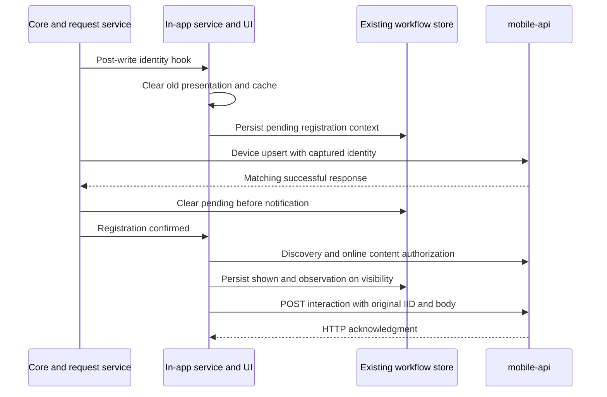

# iOS SDK workflow In-app implementation plan

Status (November 3, 2026): source implementation and six review passes are
complete. Native verification, device certification, and release are pending.
Branch: `feat/in-app-workflow`.
Implementation baseline: `862ed2acecc404a1e58572f7950a3dd347d4b672`.

Use the [shared SDK contract and regression matrix](../../../esputnik-product-docs/changes/CHG-2026-0002-in-app-workflow-delivery/mobile-sdk-implementation-plan.md)
for cross-platform behavior and the
[transport and acknowledgment contract](../../../esputnik-product-docs/changes/CHG-2026-0002-in-app-workflow-delivery/mobile-sdk-implementation-plan.md#workflow-interaction-transport-and-acknowledgment)
for wire details. The [Android plan](../../../reteno-mobile-android-sdk/docs/in-app-workflow/README.md)
records platform-specific differences. This document covers iOS only.

## Implementation plan

The source changes below are implemented locally. Acceptance tests are added
but have not executed on this host.

| Area | Implementation | Acceptance |
| --- | --- | --- |
| Discovery and content | [InAppMessageLists](../../Reteno/Sources/InAppMessages/Models/InAppMessageLists.swift), [InAppContents](../../Reteno/Sources/InAppMessages/Models/InAppContents.swift), and existing request adapters decode optional workflow metadata. Discovery sends `includeWorkflow=true`. Workflow `messages` and ordinary `messageInstanceIds` content requests remain separate. | Mixed lists preserve ordinary entries and distinct IIDs sharing a snapshot. Missing/false `inWorkflow` retains ordinary behavior. |
| Execution state | Existing [KeyValueStorage](../../Reteno/Sources/Storage/KeyValueStorage.swift) holds shown markers, deadlines, separate queued observations, and pending contact registration in one workflow state value. | Restart retains execution isolation and suppression. Account changes cannot display old content or replay events under new credentials. |
| Eligibility and rendering | [InAppService](../../Reteno/Sources/InAppMessages/Services/InAppService.swift) reuses existing rules, skips only workflow FREQUENCY, and authorizes content online before first display. The renderer applies the execution's prepared JSON map to the raw model. | Failed or unsupported enabled conditions defer display. Changed non-frequency rules invalidate authorization; ordinary cached-user substitution cannot replace workflow values. |
| Visibility and retry | [InAppMessages](../../Reteno/Sources/InAppMessages/InAppMessages.swift) observes actual UIKit presentation completion. [NewInteraction](../../Reteno/Sources/InAppMessages/Models/NewInteraction.swift) retains the server IID and original observation. | OPENED/CLICKED establish local shown state. Retry preserves IID, snapshot, UTC-seconds time, and full body. FAILED before visibility does not mark shown; dismissal stays local. |
| Clicks and compatibility | Workflow OPENED, CLICKED, and FAILED use POST interaction. CLICKED retains the full existing CTA action. Ordinary clicks keep PUT. | Persistence and retry preserve `type`, `targetComponentId`, and `url`; ordinary IID generation, frequency records, and pause behavior remain compatible. |

No delivery-method enum, event identifier, workflow feature flag, SDK TTL
default, or Velocity engine is introduced. Workflow content is not restored
for offline first display. Repeated discovery or HTTP 304 does not clear shown
state or extend `expiresAt`.
Use `expiresAt` as the absolute deadline for first display; fetching content,
retrying, or restarting does not start a new availability timer.

## iOS behavior

### Persistence and retry

Shown state and each observation are recorded together through the existing
workflow store. The existing scheduler allows up to eight attempts with bounded
backoff and `Retry-After` handling. Acknowledgment or terminal delivery failure
removes the queued observation while retaining local suppression. Original
ordinary frequency records remain intact.

Retry requests capture the owning context and authenticated headers together.
A concurrent account change cannot substitute new credentials for an old
observation.

### Presentation and current rules

Workflow HTML bypasses ordinary cached-user substitution and uses its own
prepared map. Two IIDs sharing a snapshot retain separate personalized output.
The current evaluator supports workflow AND targeting with time and app-event
conditions. Unsupported shapes and enabled conditions, including the existing
unevaluated NEW_USER condition, remain deferred.

Context clearing dismisses the current window or slide-up on the main queue,
including switches to an anonymous account. Inactivity cancels unfinished
workflow presentation; foreground retry evaluates current rules and authorizes
content again. Foreground processing runs on main even when base HTML is cached.
Ordinary skip/postpone behavior and existing presenters remain intact.

Non-frequency rule changes invalidate pending or authorized content before
presentation; frequency-only edits do not. Failure to load ordinary content
from a mixed list leaves eligible workflow candidates available and completes
the discovery callback.

### Contact registration

Core invokes a synchronous workflow hook after local identity writes and passes
the immutable pre-write context. An actual context change clears the old UI and
cache; an unchanged context preserves them. Clearing synchronizes the service's
in-memory owner as well as persisted context. Service-detected changes establish
the registration barrier before advancing cache ownership.

Pending registration survives restart and blocks mixed discovery, cached
reprocessing, workflow authorization, and presentation until the current
contact's device upsert succeeds. Mixed discovery must wait because the server
can still resolve the device to the previous contact. Push-by-IID is outside
this gate.

The upsert freezes actual application/device/contact fields and headers. Only
a matching successful current-context response clears pending in storage,
before notifying UI listeners. Generic user-update completions, duplicate
no-op updates, and stale acknowledgments cannot release it. The existing
scheduler retries pending registration even when a late same-device response
sets the legacy updated-device Boolean. One matching acknowledgment is enough;
no extra discovery or second upsert is required to synchronize context.
Generic notification timing and listeners remain unchanged.



The [shared acknowledgment contract](../../../esputnik-product-docs/changes/CHG-2026-0002-in-app-workflow-delivery/mobile-sdk-implementation-plan.md#workflow-interaction-transport-and-acknowledgment)
requires synchronous backend shown-state storage for OPENED/CLICKED, followed by
Kafka broker acknowledgment before HTTP success. FAILED does not update shown
state. Backend storage and publication are not atomic; retry the saved body
without redisplaying the IID. Cross-device exactly-once display and event-level
exactly-once analytics are not guaranteed.

## Verification

| Check | Recorded result |
| --- | --- |
| Source review | Six reviewer passes completed; final review has no remaining confirmed findings. |
| Swift syntax | Official Swift 5.9.2 compiler parsed 22 changed source/test files in a network-disabled container with the checkout mounted read-only. |
| Documentation and diff | Relative links and `git diff --check` pass. |
| XCTest, UIKit type checking, simulator/device execution | Not executed: macOS/Xcode is unavailable on this host. |
| Renderer, wrappers, backend integration | Pending. |

Syntax checks do not establish UIKit type checking or native runtime behavior.

The focused regressions are in
[InAppServiceTests](../../RetenoExample/RetenoExampleTests/Tests/InApp/InAppServiceTests.swift),
[InAppRequestServiceTests](../../RetenoExample/RetenoExampleTests/Tests/InApp/InAppRequestServiceTests.swift),
and [InAppPersonalisationTests](../../RetenoExample/RetenoExampleTests/Tests/InApp/InAppPersonalisationTests.swift).
They cover mixed lists and ordinary-content failures, prepared-map isolation,
rule changes, visibility state, restart/retry, credential capture, identity
writes, no-op updates, stale device acknowledgments, and single-ack recovery.

On macOS with Xcode, run from the repository root:

```bash
xcodebuild -showdestinations -project RetenoExample/RetenoExample.xcodeproj -scheme RetenoExampleTests
xcodebuild test -project RetenoExample/RetenoExample.xcodeproj -scheme RetenoExampleTests -destination 'platform=iOS Simulator,id=<installed-simulator-id>'
```

Select an installed simulator ID from the first command. Use isolated stores,
controlled callbacks, and fixed test time for recovery and expiry scenarios.

## Remaining work

- Run XCTest, UIKit type checking, store-upgrade, and recovery scenarios.
- Verify actual window/slide-up visibility, inactivity during presentation,
  anonymous account changes, background/foreground, termination, reconnect,
  expiry, clicks, and dismissal on devices.
- Certify supported renderer/wrapper versions and backend integration. Showing
  E1 must leave a different IID E2 independently available.
- Record the evidence and publish through the SDK release process only after
  certification. Source review and backend completion do not establish SDK
  release readiness.
